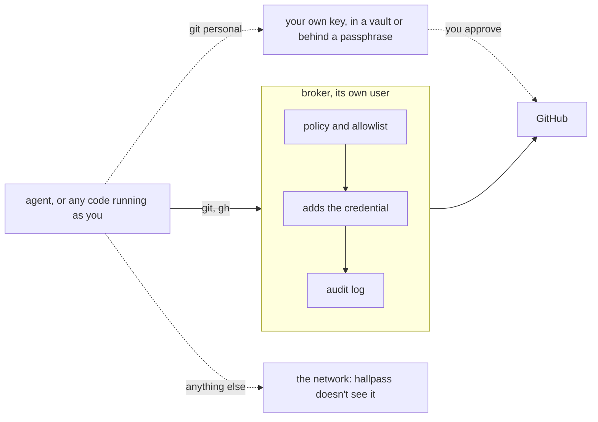

# hallpass

hallpass lets coding agents use git and gh on GitHub without holding a
credential. A broker runs as its own user and holds up to three: a GitHub
token, an SSH key, and a signing key. git and gh send their requests through
the broker's Unix sockets. The broker checks each request against a policy,
uses the credential itself, and logs the request. Nothing hallpass puts in
an agent's reach holds a secret, so code that goes around the broker reaches
GitHub with none of hallpass's credentials. Your own credentials are yours to
lock down; see [Use your own credentials](#use-your-own-credentials).

Each credential is optional and turns on its own features:

| Credential | Turns on |
| --- | --- |
| Token: a device login or a classic PAT, `repo` scope only | gh, and the check that refuses git under a renamed repo's old name |
| SSH key, ECDSA P-256 | git |
| Signing key, ECDSA P-256 | signed commits and tags |

Where each one is kept, and who can reach it, depends on the platform. See
[Protection by platform](#protection-by-platform).

Every credential acts as you on GitHub, so it works in your repos and your
orgs' repos without an app install. Orgs that restrict OAuth apps reject
the device login, and [Set up a machine](#set-up-a-machine) covers them. The allowlist in `/etc/hallpass/hallpass.toml` decides which repos
agents reach.

## What it prevents and mitigates

hallpass assumes code running as you is hostile: a malicious npm
`postinstall` script, a poisoned dependency, or an agent that was talked into
something. It aims to keep that code from taking a GitHub credential, and to
limit what it can do on GitHub through the broker. How much to limit is your
call: the policy is set to your risk tolerance. hallpass limits what agents
do on GitHub. It isn't a network sandbox, and it doesn't limit where data
goes.



It prevents these:

- **Theft of a credential by code running as you.** The broker runs as its
  own user (`hallpass`, or `_hallpass` on macOS). Its files are mode 0600 and
  its state directory is closed to others, so your processes can't read them
  or attach a debugger to the broker. git and gh never see a token or key.
  Root can do both. What protects the credentials from root depends on the
  platform; see [Protection by platform](#protection-by-platform).
- **Reaching repos you didn't allow.** The broker refuses any repo the
  allowlist doesn't cover, for git, gh, and GraphQL node IDs. GraphQL
  reads that walk from an allowed repo into another one, through an owner,
  an author, a fork, or a cross-reference, see only names, IDs, numbers,
  titles, and states, never bodies, code, or comments. Of a repo reached
  that way, like a fork's parent, they also see its description, its
  default branch's name, your permission there, and whether it has issues
  and a wiki, which `gh pr create` reads. GitHub keeps a repo's old name
  working after a rename or transfer, so with a token the broker asks
  GitHub what a repo is called now before running git there, and refuses
  an old name. On a machine with only an SSH key it can't ask, so an old
  name that the allowlist covers still reaches the renamed repo.
- **Merging, approving, and pushing the default branch, unless you allow
  it.** By default, agents can't merge or approve PRs, push the default
  branch, add labels, or rerun or dispatch workflows. You can allow each of
  these everywhere or in one repo. See [Policy](#policy).
- **Pushing tags, protected branches, and your branches.** No policy allows
  these. Agents can't push a tag or a branch that `protected_branches`
  names. The default branch is the one exception: `push.default` alone
  decides it. Agents also can't update or delete a branch they didn't
  create. The broker remembers the commit an agent last pushed to each
  branch. Once you push a commit of your own to the branch with
  `git personal`, or delete it and make it again at another commit, it's
  yours. A branch you recreate at the agent's own last commit still counts
  as the agent's, since it holds only the agent's work.
- **Workflow injection.** Shai-Hulud committed a workflow to send repo
  secrets out. git goes over SSH, where GitHub doesn't check workflow
  changes, so the broker reads every pushed pack and refuses a branch whose
  new commit changes `.github/workflows`. That check is the only guard: the
  token's missing `workflow` scope doesn't apply, because pushes don't use
  the token. Through gh, the broker refuses every write to the contents API,
  and `login` and `install-pat` refuse tokens with `workflow` scope.
- **Settings, secrets, and admin.** The broker refuses repo settings,
  branch protection, hooks, deploy keys, secrets and their names, release
  changes, and deletes, and no policy can allow them. It also refuses
  anything outside an allowed repo's API, such as creating a repo or a gist
  on your account. It refuses reading rulesets and Actions variables unless
  the policy allows it. Any request not on its lists is refused, including
  whatever GitHub adds later.
- **Commands for bots.** PR and issue text with lines like `/merge` or
  `bors r+` is refused, because bots would take them as your command.
- **Silent fallback to your credentials.** The git config rewrites every
  form of github.com remote to SSH and sets `core.sshCommand` to
  `hallpass ssh`, which sends github.com to the broker, never to your own
  key. It also clears every credential helper for github.com, so an HTTPS
  request that slips through stops instead of falling through to a keyring
  token or a prompt.

It mitigates these:

- **Agents changing other people's work as you.** Agent PRs, comments, and
  pushes show as you, so no org has to approve anything, and nobody can tell
  them from yours. To keep that from reaching colleagues, agents can edit
  only PRs, issues, and comments you wrote.
- **A stolen token.** A PAT expires within a year, and `status` warns from
  14 days out. A device-login token doesn't expire. Run `login` again every
  few months, which revokes the old one.
- **Not knowing what happened.** The broker logs every request it allows or
  refuses, with the client's uid and process chain, for example
  `git push origin fix < claude`. Read the log with
  `sudo journalctl -u hallpass` on Linux, or `sudo cat /var/log/hallpass.log`
  on macOS. The client controls its command line, so treat the chain as a
  lead, not proof.
- **Commits made elsewhere in your name.** Anyone can set git's author to
  you. With the signing key, the git config turns on `commit.gpgsign` and
  `tag.gpgsign`, so every git on the machine signs every commit and tag
  with the broker's key, yours included, and GitHub shows them as Verified.
  A commit in your name from anywhere else doesn't verify, unless another
  signing key on your GitHub account signed it. Verified means
  "made on this machine", not "you reviewed it", since anything running as
  you can get a commit signed. `git personal` commits use your own signing
  setup, if you have one.

It doesn't protect against these:

- **Hostile code using the broker.** Anything running as you
  can ask the broker for whatever its policy allows, in every allowed repo.
  Keep the allowlist to the repos agents need.
- **Data leaving the machine.** hallpass keeps the credentials, not your
  code. An agent can read any allowed repo and send what it read anywhere
  on the network. It can also write data into an allowed repo, through a
  branch, a PR, an issue, or a comment, and in a public repo that publishes
  it. `--read` entries and a short allowlist narrow this. Stopping it takes
  a network sandbox.
- **Your own credentials.** If agents can reach your own SSH key, your
  password manager, or a logged-in gh, they can go around hallpass. See
  [Use your own credentials](#use-your-own-credentials).
- **Root.** Root can use every credential on the running machine, and on
  some platforms copy it off. See
  [Protection by platform](#protection-by-platform).
- **A compromised setup session.** Setup runs `sudo` from your shell. If code
  running as you replaced `sudo` on your PATH, or edited the checkout you
  build from, it gets root. Install from an attested release binary, from a
  shell you trust, and run `sudo -k` afterward.
- **Code that agents push.** An agent can push a malicious change to a
  branch and open a PR for it. Review PRs before you merge them.
- **Secrets in existing workflows.** Agents can't edit workflows, but a
  workflow that runs on `push` or `pull_request` runs the agent's branch code
  with the secrets it references.
- **Bots the filter doesn't know.** The filter covers common
  triggers, not every bot's grammar.
- **Composite actions.** Like GitHub's, the workflow check covers
  `.github/workflows`, not actions elsewhere in the repo that workflows use.

## Protection by platform

Everywhere, the broker runs as its own user, so code running as you can't
read the credentials or attach a debugger to the broker. What happens past
that depends on the platform:

| | Linux with a TPM | Linux without a TPM | macOS |
| --- | --- | --- | --- |
| Credentials | keys generated inside the TPM; token sealed to it | plain 0600 files | 0600 files, encrypted under a key tied to the Mac |
| A root tool sweeping the disk for secrets | finds only TPM-wrapped blobs | finds the keys and the token | finds no PEM key or `gho_` token |
| A copied disk or backup | opens nothing | holds every credential, unless the disk is encrypted | doesn't open on another Mac, and Time Machine skips it |
| Root on the running machine | can use every credential and read the token, but can't copy the keys off | can copy every credential | a generic sweep gets only ciphertext, but malware written for hallpass can decrypt and copy every credential |

On macOS, the Secure Enclave would keep the keys from leaving, but a
launchd daemon can't use it. So the broker encrypts each credential with
AES-256-GCM, under a key from three inputs: a random secret made when you
first set up a credential, the Mac's serial number and hardware UUID, and
the data volume's UUID. A copy of `/var/db/hallpass` lacks the last two, and
`system_profiler SPHardwareDataType` prints neither the secret nor the volume
UUID. Root can read all three inputs, so root malware written for hallpass
can rebuild the key. Replacing the logic board or erasing the disk means setting the
credentials up again. `doctor` warns about credentials made before this,
which are still plain files.

If root is compromised on any platform, run `login` again and recreate both
keys.

## How it works

`install` writes `/etc/hallpass/gitconfig` for the credentials that exist and
includes it from each git's system config:

- **git.** github.com remotes, in every form, are rewritten to
  `ssh://git@github.com/`, and `core.sshCommand` is `hallpass ssh`. For
  github.com it sends the git command to the broker's socket and relays the
  data. The broker connects to GitHub with its key, checking GitHub's
  published host keys, and runs only `git-upload-pack` and
  `git-receive-pack`. For any other host, `hallpass ssh` runs the real ssh.
- **gh.** `hallpass gh` runs gh with `GH_CONFIG_DIR=/etc/hallpass/gh`, whose
  `http_unix_socket` setting sends gh's requests as plain HTTP to the broker.
  The broker classifies each REST route and GraphQL document against
  GitHub's schema, resolves node IDs to repos, and adds the token.
- **Signing.** `gpg.ssh.program` is `hallpass-sign`, which takes
  `ssh-keygen -Y sign` arguments. For the broker's key it asks the broker,
  which signs only git commits and tags. Everything else goes to the real
  `ssh-keygen`.

git goes over SSH only, and gh uses the token. With a token and no SSH key,
the git config still sends github.com to the broker, which refuses git and
says to run `sudo /opt/hallpass/bin/hallpass ssh-key create`. git never falls
through to your own credentials. The broker dials `github.com:22`, so a
network that blocks port 22 can't reach GitHub through hallpass.

## Policy

Each thing agents may do has a name, like `pr.merge` or `push.default`. A
name covers every way of doing it: the REST route, the GraphQL mutation, and
the git push. Denying `pr.merge` refuses `gh pr merge` and
`gh api -X PUT .../merge` alike. `hallpass policy show` lists them:

| On by default | Off by default |
| --- | --- |
| `pr.create`, `pr.edit`, `pr.request-review`, `issue.edit`, `comment`, `review.comment` | `issue.create`, `assign`, `push.default`, `review.verdict`, `pr.merge`, `labels`, `workflow.rerun`, `workflow.dispatch` |

`review.verdict` covers approving and requesting changes. `pr.merge` covers
merging, the merge queue, and auto-merge.

Change them for every repo, or for one allowlist entry:

```sh
sudo /opt/hallpass/bin/hallpass policy allow workflow.rerun
sudo /opt/hallpass/bin/hallpass policy allow push.default pr.merge --repo mbriggs/dots
sudo /opt/hallpass/bin/hallpass policy deny labels --repo acme/*
sudo /opt/hallpass/bin/hallpass policy reset pr.merge --repo mbriggs/dots
hallpass policy show mbriggs/dots     # what's in effect there, and which layer set it
```

The layers apply in order: the defaults, then the global lists, then the
`OWNER/*` entry, then the exact entry. The most specific layer that names an
operation decides it.

If `--repo OWNER/NAME` has no entry of its own but `OWNER/*` covers it,
the command adds an `OWNER/NAME` entry with the same access to hold the
policy. When a `reset` leaves such an entry with no policy, it offers to
remove it.

`allow` prints a warning for the risky operations, among them:

- `review.verdict`: an approval or change request through hallpass counts
  as yours.
- `pr.merge` lets agents merge, or turn on auto-merge, with nobody
  reviewing.
- `workflow.dispatch` lets agents pick the ref and inputs of a workflow
  that often deploys with real secrets.
- `push.default` passes even when `protected_branches` names the default
  branch. Agents still can't delete it, but they can force-push it, because
  the broker can't tell a force push from a fast-forward. Turn on GitHub's
  branch protection if its history matters.

A refusal names the operation and the command that would allow it:

```text
GraphQL: hallpass: agents may not merge PRs or add them to the merge queue in acme/widgets. To allow it: sudo /opt/hallpass/bin/hallpass policy allow pr.merge --repo acme/widgets
```

The settings live in `/etc/hallpass/hallpass.toml` as `allow` and `deny`
lists, at the top level and on each `[[repo]]`.

### API reads

Two more kinds of name open or close reads that the built-in tables don't
cover, with the same `allow`, `deny`, and `reset`, and no rebuild:

```sh
sudo /opt/hallpass/bin/hallpass policy allow read:deployments --repo acme/widgets
sudo /opt/hallpass/bin/hallpass policy deny read:actions/runs/#/logs --repo acme/secret
sudo /opt/hallpass/bin/hallpass policy allow field:Repository.hasProjectsEnabled
```

- `read:PATTERN` is a GET route under `/repos/{owner}/{repo}`. `#` matches
  a number, `*` one name, and a final `**` the rest of the path. It layers
  like an operation, and within one layer a deny wins.
- `field:Type.field` is a field that GraphQL reads may see of a repo or
  account outside the one a request named, like a fork's parent. It applies
  to every repo, and only scalar and enum fields qualify, so it can't open
  a path into another repo's issues or code.

A refusal that one of these would fix names it:

```text
hallpass: hallpass doesn't allow reading repos/{repo}/deployments in acme/widgets. Reads are limited to code, PRs, issues, checks, and Actions runs. To allow it: sudo /opt/hallpass/bin/hallpass policy allow read:deployments --repo acme/widgets
```

No name adds a write, and none opens secrets and their names, Actions
permissions and runners, environment secrets and variables, branch
protection, Dependabot, Codespaces, hooks, deploy keys, invitations,
security findings, or `Repository.tempCloneToken`. Rulesets
(`read:rulesets`) and Actions variables (`read:actions/variables`) are
off by default, and a policy can open them.

The broker checks each client's uid against `uids` in the config, from the
kernel's peer credentials. The git config applies to everyone on the machine,
so hallpass suits a machine with one user.

## Use your own credentials

For anything the policy refuses, use your own credentials:

```sh
git personal push            # git without hallpass's config
```

`git personal` runs git with `GIT_CONFIG_NOSYSTEM=1`, so remotes stay as
written and your own SSH key and helpers answer. Plain gh, without
`hallpass gh` or its config dir, uses your own login.

`git personal` is how you step in for what agents can't do, so keep your
own key behind something that asks you first: a vault's SSH agent, like
1Password's, or a key encrypted with a passphrase. hallpass can't stop code
running as you from using your own credentials. An unencrypted key in
`~/.ssh` or a gh login with no prompt hands agents everything hallpass
refuses them, and then hallpass isn't doing much. `doctor` warns about each
SSH agent and gh login it finds. A vault's agent sets off the warning too,
which is expected: the vault, not hallpass, decides when to ask you.

## Set up a machine

The `skills/hallpass-setup` skill walks an agent through setup with you. The
core steps:

```sh
sudo ./hallpass-linux-amd64 install                 # or ./bin/hallpass from make build
sudo /opt/hallpass/bin/hallpass login               # token by device login, for gh
sudo /opt/hallpass/bin/hallpass ssh-key create      # for git: add the key on GitHub
sudo /opt/hallpass/bin/hallpass signing-key create  # optional: add as a signing key
sudo /opt/hallpass/bin/hallpass allow 'you/*'
hallpass status --check    # the broker's credentials, checked with GitHub
hallpass doctor            # this machine's git, gh, and signing setup
```

`install` offers to copy the `hallpass-setup` and `hallpass-repo` skills into
`~/.claude/skills` and `~/.agents/skills`, and to update them when a new
binary brings changes. It runs `hallpass skills` as you to do it, and you can
run that yourself any time.

`login` runs GitHub's device flow as root, with GitHub CLI's client ID and
the `repo` scope, so the token goes straight from GitHub into storage. Orgs
that restrict OAuth apps and haven't approved GitHub CLI reject it. For those,
paste a classic PAT with `install-pat` instead.

Release binaries for Linux and macOS, amd64 and arm64, are on the
[releases page](https://github.com/mbriggs/hallpass/releases) with build
provenance. Verify a download before running it as root:

```sh
gh attestation verify hallpass-linux-amd64 --repo mbriggs/hallpass
```

## Commands

Run `hallpass help` for the full list. Root commands go through
`/opt/hallpass/bin/hallpass`, not a copy on your PATH.

| Command | Runs as | Does |
| --- | --- | --- |
| `install` | root | Installs the binary, service, and git and gh config, or upgrades them |
| `login` | root | Gets a token by device login |
| `install-pat` | root | Stores a classic PAT you paste |
| `logout` | root | Removes and revokes the token |
| `ssh-key create\|remove\|show` | root | Manages the SSH key |
| `signing-key create\|remove\|show` | root | Manages the signing key |
| `allow OWNER/REPO [--read]` | root | Lets agents use a repo, or `OWNER/*` |
| `disallow OWNER/REPO` | root | Removes an allowlist entry |
| `policy allow\|deny\|reset OP... [--repo OWNER/REPO]` | root | Changes what agents may do, everywhere or in one entry |
| `policy show [OWNER/REPO]` | you | Lists the operations, or what's in effect in one repo |
| `uninstall [--purge]` | root | Removes what `install` added. `--purge` also revokes the token and deletes the credentials and config |
| `status [--check]` | you | Reports the broker's state. `--check` also asks GitHub |
| `doctor` | you | Checks this machine's git, gh, and signing setup against the broker |
| `ledger add OWNER/REPO BRANCH COMMIT` | root | Lets agents update a branch they didn't create, while it points at COMMIT |
| `ledger list OWNER/REPO` | root | Lists the branches agents may update |
| `skills` | you | Installs or updates the agent skills; `install` offers this |
| `gh ARGS` | you | Runs gh through the broker |

## License

MIT. See [LICENSE](LICENSE).
